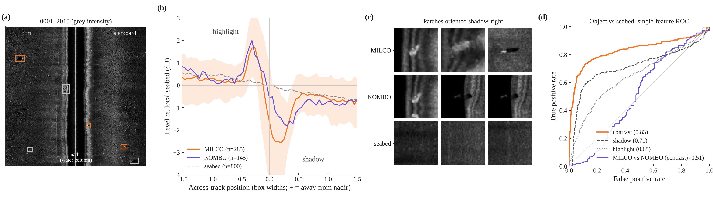
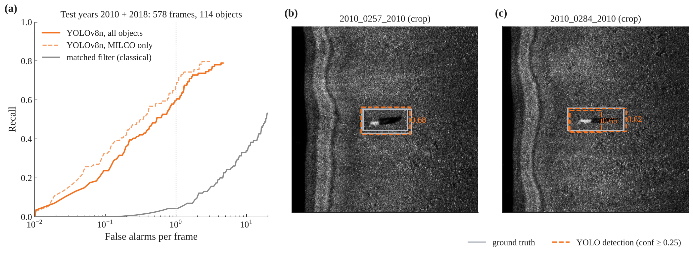
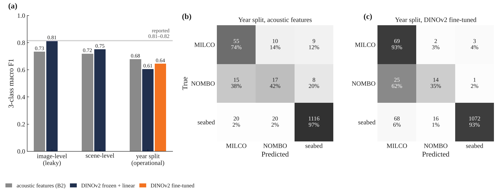
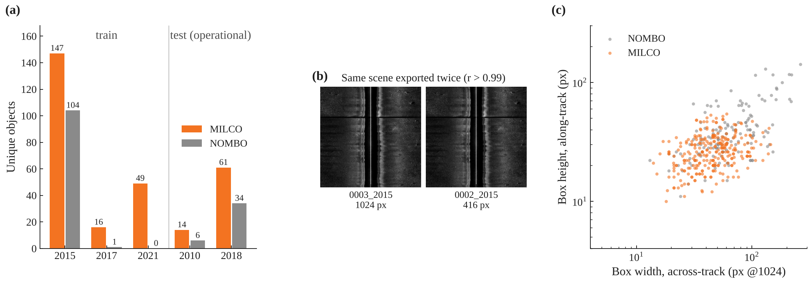

# Side-Scan Sonar Mine Detection Benchmark

공개 측면주사 소나(Side-Scan Sonar, SSS) 영상에서 기뢰유사물체(mine-like object) 탐지기와 패치 분류기를 촬영 연도 분할 조건으로 평가한 프로젝트입니다.

## Overview

- **문제**: 공개 AUV 측면주사 영상 자료에는 같은 장면의 축소 복사본이 많고(1,170장 중 417쌍), 연도별 물체 구성이 크게 달라 이미지 단위 무작위 분할에서는 성능이 과대평가될 수 있습니다.
- **방법**: 중복 장면을 점검한 뒤 공식 연도 분할(학습 2015 · 2017 · 2021 → 시험 2010 · 2018)로 평가했습니다. 탐지는 고전 정합필터와 YOLOv8n, 분류는 하이라이트–그림자 물리 특징과 DINOv2를 비교했습니다.
- **결과**: 처음 보는 연도에서 YOLOv8n의 Pd는 78.1%(영상당 오경보 4건), 정합필터는 4.3%(1건)였습니다. 연도가 바뀔 때 분류 성능 하락은 물리 특징(0.04)이 DINOv2(0.15)보다 작았습니다.
- **연계**: YOLO 후보를 물리 특징 분류기로 다시 판정하면 영상당 오경보 1건 기준 Pd가 59.6%에서 70.2%로 올랐습니다.

<p align="center"></p>

## Results

| 탐지 (시험 연도 2010 · 2018) | Pd @ 영상당 오경보 1건 | Pd @ 4건 |
|---|---|---|
| YOLOv8n | 59.6% | 78.1% |
| 고전 정합필터 | 4.3% | — |

<p align="center"></p>

YOLOv8n의 mAP@0.5는 0.101(MILCO 0.19, NOMBO 0.01)입니다. 표적이 1024 px 영상에서 폭 수십 px로 작아 IoU 0.5 기준에 불리하므로, 탐지 위치 기준의 Pd와 함께 봅니다.

| 패치 3분류 macro F1 | 이미지 분할 | 장면 분할 | 연도 분할 |
|---|---|---|---|
| 물리 특징 + 로지스틱 회귀 | 0.734 | 0.719 | 0.679 |
| DINOv2 고정 특징 + 선형 분류기 | 0.814 | 0.751 | 0.606 |
| DINOv2 미세조정 | — | — | 0.645 |

<details>
<summary>분할별 분류 결과 · 혼동 행렬</summary>

<p align="center"></p>
<p align="center"><sub>분할별 3분류 macro F1과 연도 분할 혼동 행렬 (정답 위치 패치 조건)</sub></p>

</details>

- 하이라이트–그림자 대비는 물체와 해저 배경을 구분했지만(AUROC 0.830), 물체 종류(MILCO vs NOMBO) 구분력은 낮았습니다(0.513).
- 결과 수치: [`src/b3_yolo.json`](src/b3_yolo.json), [`src/b2_results.json`](src/b2_results.json), [`src/b3_patch.json`](src/b3_patch.json) · 결과 리포트: [`docs/milco-report.html`](docs/milco-report.html)

## Cascade (탐지 → 분류 연계)

YOLOv8n 후보마다 하이라이트–그림자 물리 특징으로 MILCO · NOMBO · 해저 배경을 다시 판정하고, 배경으로 판정된 후보를 버립니다. 재판정 임계값은 YOLO 학습에 쓰지 않은 학습 연도 장면(검증 26장, 물체 47개)에서 정하고 시험 연도(578장, 물체 114개)에 한 번 적용했습니다.

| 영상당 오경보 | Pd, YOLO 단독 | Pd, + 재판정 | Pdc, YOLO 단독 | Pdc, + 재판정 |
|---|---|---|---|---|
| 0.5 | 48.2% | 53.5% | 39.5% | 43.0% |
| 1 | 59.6% | 70.2% | 46.5% | 51.8% |
| 2 | 72.8% | 74.6% | 55.3% | 55.3% |
| 4 | 78.1% | 74.6% | 59.6% | 55.3% |

Pd는 탐지 위치가 맞은 비율, Pdc는 위치와 종류(MILCO / NOMBO)가 모두 맞은 비율입니다. 오경보는 1024 px 영상 1장 기준입니다.

- 영상당 오경보 1건 이하에서 재판정이 Pd를 5–11%p 올렸습니다. 재판정이 맞는 후보 일부도 버리므로 최대 Pd는 78.9%에서 74.6%로 낮아집니다.
- 탐지기 단독 Pd의 상한이 79%입니다. 물체의 약 21%는 후보에 오르지 않습니다.
- 검증 장면에서 Pd 91%가 되도록 정한 탐지 임계값이 시험 연도에서는 Pd 57%였습니다. 연도가 바뀌면 운영점이 이동하므로, 새 조사 자료로 임계값을 다시 맞추는 절차가 필요합니다.
- YOLO 오경보를 배경으로 추가 학습한 재판정은 맞게 찾은 물체의 25%를 잃어 채택하지 않았습니다.
- 결과 수치: [`src/b4_cascade.json`](src/b4_cascade.json)

<details>
<summary>면적당 오경보 예시 (가정 조건)</summary>

기뢰 탐색 성능은 보통 면적당 오경보(FA/km²)로 비교하지만, 공개 자료에는 환산에 필요한 정보가 없습니다. 아래는 조건을 가정해 계산한 예시이며, 다른 연구와의 비교에는 쓸 수 없습니다.

| 항목 | 가정 값 |
|---|---|
| 거리(range) 설정 | 한쪽 50 m, 스와스 100 m |
| 횡방향 픽셀 크기 | 100 m / 1024 px ≈ 0.098 m |
| 핑 간격 | 최대 핑 속도 1500 / (2 × 50 m) = 15 Hz, 속력 1.5 m/s → 0.1 m |
| 고도 | 경사거리 → 수평거리 보정 생략 |
| JPEG 내보내기 | 1행 = 1핑, 1024 px 영상, 416 px 영상도 같은 면적 |

영상 1장 ≈ 100 m × 102 m ≈ 0.010 km²

| 영상당 오경보 | 면적당 오경보 (가정) |
|---|---|
| 0.5 | 약 49 /km² |
| 1 | 약 98 /km² |
| 2 | 약 195 /km² |
| 4 | 약 391 /km² |

거리 설정을 한쪽 25 m로 바꾸면 영상 면적이 1/4이 되어 면적당 오경보는 4배가 됩니다. 실제 환산에는 연도별 거리 · 스와스 설정, 픽셀 크기, 핑 간격 · 고도, JPEG 내보내기 방식이 필요하지만 공개 자료(Santos et al. 2024)에는 없습니다.

</details>

## Dataset

- Santos et al. 2024, *Data in Brief* (CC BY 4.0) — Gavia AUV · Marine Sonic 900/1800 kHz, JPEG 1,170장(고유 장면 753개), MILCO · NOMBO 라벨
- 원자료는 저장소에 포함하지 않으며 `src/download_data.sh`로 받습니다.

<details>
<summary>자료 점검 (중복 장면 · 연도별 구성)</summary>

<p align="center"></p>
<p align="center"><sub>연도별 고유 물체 수, 축소 복사본 예시, 표적 크기</sub></p>

</details>

## Getting Started

```bash
pip install -r requirements.txt
cd src
./download_data.sh      # 공개 자료 내려받기
python screen.py        # 중복 장면 점검
python b2.py            # 전처리 · 정합필터 탐지
python prep_tiles.py && python train_yolo.py && python b3_yolo_eval.py   # YOLOv8n 학습 · 평가
python b3_patch.py 2    # 패치 3분류
python b4_cascade.py    # 탐지 → 분류 연계
```

결과 JSON과 학습된 탐지기 가중치가 저장소에 있어 원자료 없이도 수치를 확인할 수 있습니다.

## Project Structure

| 폴더 | 내용 |
|---|---|
| `src` | 점검 · 전처리 · 탐지 · 분류 스크립트, 결과 JSON, YOLO 가중치 |
| `docs` | 그림, 결과 리포트(HTML) |

## Limitations

- CPU로 학습한 소형 모델(YOLOv8n, 25 epoch)이며, 입력은 원시 신호가 아닌 JPEG 영상입니다.
- 패치 분류 표는 정답 위치 패치 조건의 결과입니다. 연계 평가의 임계값은 검증 장면 26장으로 정해 표본이 작습니다.
- 공개 자료에 거리 설정과 픽셀 크기가 없어 오경보를 면적당으로 환산하지 못했습니다.
- 한 자료(한 장비 · 해역 계열)의 결과입니다.

## License

코드는 MIT License를 따릅니다. 자료와 자료에서 파생된 그림은 Santos et al. 2024의 CC BY 4.0 조건을 따릅니다.
