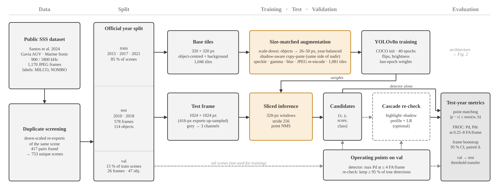
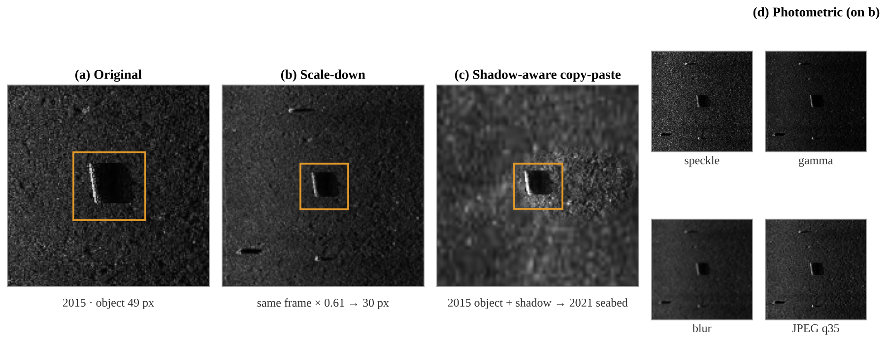
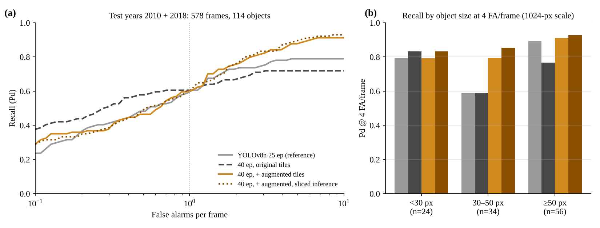
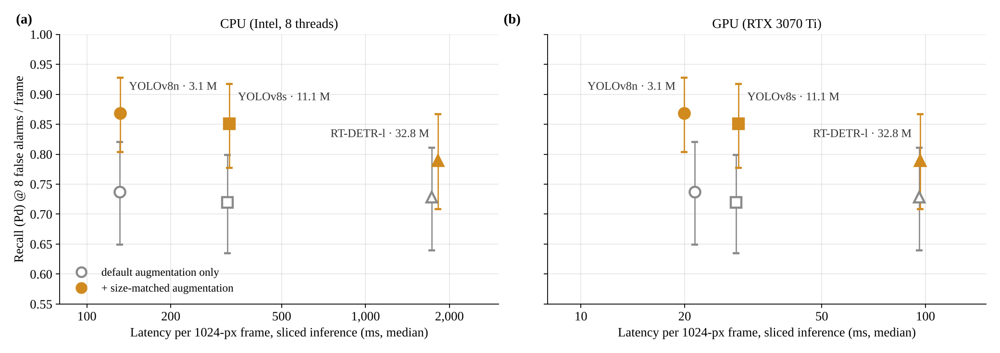
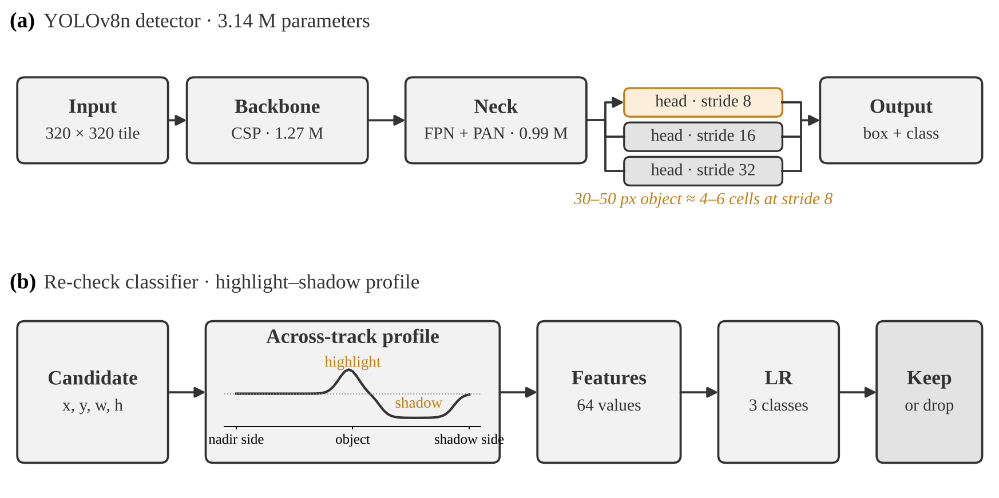

# Side-Scan Sonar Mine Detection Benchmark

공개 AUV 측면주사 소나(Side-Scan Sonar, SSS) 영상으로 기뢰유사물체(mine-like object) 탐지기를 구축하고, 학습에 쓰지 않은 촬영 연도에서 성능을 검증한 프로젝트

<p align="center"></p>

## 1. 연구 배경

- **고전 연구 (물리 모델 기반)**
  - SSS 기뢰 탐지는 표적 반사(하이라이트)와 후방 음향 그림자 쌍을 검출하는 방식으로 발전함
  - 영상을 하이라이트 · 해저 잔향 · 그림자로 분할한 뒤 공간 관계로 표적을 추출함 (Reed 등, 2003)
  - 정합필터 기반 검출이 기본 기준선으로 쓰임 (Turin, 1960)
- **딥러닝 전환 (2016년 이후)**
  - CNN 기반 소나 표적 분류가 시도됨 (Williams, 2016)
  - 학습 자료 부족을 보완하려고 일반 영상으로 사전학습된 모델을 전이함 (McKay 등, 2017)
- **현재 흐름**
  - YOLO 계열 · Transformer 계열 범용 탐지기를 SSS에 적용함 (Steiniger)
  - 남은 과제
    - 공개 실측 자료 부족 (Santos 등, 2024; Agrawal 등, 2024)
    - 소형 표적과 해저 유사 신호로 인한 오경보 (Cui 등, 2025)
    - 해저 · 조사 조건이 바뀔 때의 성능 저하 (de Bodinat 등, 2020)

## 2. 연구 목적

- 공개 AUV SSS 자료(Santos 등, 2024)를 촬영 연도별로 나눠 미학습 연도의 탐지 성능을 평가함
  - 학습 2015 · 2017 · 2021 → 시험 2010 · 2018 (영상 578장, 물체 114개). 연도 분할은 본 프로젝트에서 설정함
  - 성능 지표: 영상당 평균 오경보 수(FA/image)별 탐지율(Pd)
- 검토 사항
  - 미학습 조사 연도에서의 탐지 성능 수준
  - 미탐지 표적 특성 분석을 통한 성능 저하 요인 규명
  - 학습 자료 보강과 모델 규모 확대의 효과 비교
  - 하이라이트–그림자 물리 특징의 오경보 저감 및 연도 간 일반화 기여 여부

## 3. 결과

| 검토 사항 | 결과 |
|---|---|
| 미학습 연도 탐지 성능 | YOLOv8n 탐지율 59.6% (FA/image 1), 78.1% (4). 정합필터 4.3% (1) |
| 성능 저하 요인 | 미탐지가 30–50 px 표적에 집중 (탐지율 59%). 학습 표적 크기 중앙값 55 px > 시험 39 px |
| 자료 보강과 모델 규모 | 크기 맞춤 증강: 탐지율 +13%p (FA/image 8). 모델 3.1 M → 32.8 M: 탐지율 변화 없음, CPU 추론 시간 2.5–14배 증가 |
| 물리 특징의 기여 | 재판정으로 탐지율 59.6% → 70.2% (FA/image 1). 연도 변화 시 분류 성능 저하폭: 물리 특징 0.04 < DINOv2 0.15 |

### 3.1 미학습 연도 탐지 성능

| 탐지 (시험 연도 2010 · 2018) | Pd @ FA/image 1 | Pd @ 4 |
|---|---|---|
| YOLOv8n | 59.6% | 78.1% |
| 고전 정합필터 | 4.3% | — |

<p align="center"></p>

- 오경보는 1024 px 영상 1장 기준
- mAP@0.5는 0.101 (MILCO 0.19, NOMBO 0.01). 표적이 폭 수십 px로 작아 IoU 0.5 기준에 불리하므로 탐지 위치 기준 Pd와 함께 제시함
- 결과 수치: [`src/b3_yolo.json`](src/b3_yolo.json), [`src/b2_results.json`](src/b2_results.json)

<details>
<summary>면적당 오경보 환산 예시 (가정 조건)</summary>

- 기뢰 대항전 운용 평가는 면적당 오경보 밀도(FA/km²)를 사용하나, 공개 자료에는 환산 정보가 없음
- 아래는 가정 조건의 예시이며, 다른 연구와의 비교에는 쓸 수 없음

| 항목 | 가정 값 |
|---|---|
| 거리(range) 설정 | 한쪽 50 m, 스와스 100 m |
| 횡방향 픽셀 크기 | 100 m / 1024 px ≈ 0.098 m |
| 핑 간격 | 최대 핑 속도 1500 / (2 × 50 m) = 15 Hz, 속력 1.5 m/s → 0.1 m |
| 고도 | 경사거리 → 수평거리 보정 생략 |
| JPEG 내보내기 | 1행 = 1핑, 1024 px 영상, 416 px 영상도 같은 면적 |

| FA/image | 면적당 오경보 (가정, 영상 1장 ≈ 0.010 km²) |
|---|---|
| 0.5 | 약 49 /km² |
| 1 | 약 98 /km² |
| 2 | 약 195 /km² |
| 4 | 약 391 /km² |

- 거리 설정을 한쪽 25 m로 바꾸면 영상 면적이 1/4이 되어 면적당 오경보는 4배가 됨

</details>

### 3.2 성능 저하 요인과 크기 맞춤 증강

- 미탐지 표적은 30–50 px(1024 px 기준)에 집중되고(Pd 59%), 학습 표적은 큰 표적이 많은 2015년 장면이 대부분임
- 학습 장면만으로 증강 타일 1,081장을 만들어 기존 타일에 더해 학습함 ([`src/prep_aug.py`](src/prep_aug.py))
  - 축소(scale-down): 표적이 26–50 px가 되도록 영상을 줄이고, 연도별 반복 횟수로 균형을 맞춤
  - 붙여넣기(copy-paste): 표적과 그림자를 함께 잘라 다른 학습 장면의 같은 쪽(nadir 기준)에 합성함
  - 광도 증강: 스페클, 감마, 블러, JPEG 재압축
  - 뒤집기 · 밝기 · 크기 ±50% · 모자이크 등 기본 증강(Ultralytics)은 비교하는 모든 학습에 공통 적용함

<p align="center"></p>
<p align="center"><sub>(a) 원본 · (b) 축소 · (c) 다른 연도 해저면에 그림자째 합성 · (d) 광도 증강 (물체 주변 160 px 확대)</sub></p>

| 시험 연도 Pd @ FA/image (YOLOv8n, CPU) | 0.5 | 1 | 4 | 8 | 30–50 px @ 4 |
|---|---|---|---|---|---|
| 기존 (25 epoch) | 48.2% | 59.6% | 78.1% | 78.9% | 58.8% |
| 기본 증강만, 40 epoch | 57.9% | 60.5% | 71.9% | 71.9% | 58.8% |
| + 크기 맞춤 증강, 40 epoch | 46.5% | 60.5% | 84.2% | 91.2% | 79.4% |
| + 크기 맞춤 증강 + 분할 추론 | 50.0% | 60.5% | 87.7% | 93.0% | 85.3% |

- 같은 epoch의 기본 증강만 대비 Pd가 FA/image 4에서 +12%p (95% CI 3–22%p), 8에서 +19%p (11–28%p) 높음
- FA/image 0.5 이하에서는 약 11%p 낮아짐
- 같은 설정을 GPU에서 60 epoch로 다시 학습하면 분할 추론 Pd는 78.9% (4) · 86.8% (8). 실행 간 차이가 약 9%p이므로 87.7%는 상한 쪽 값임
- 검증 장면에서 Pd 91%로 정한 임계값이 시험 연도에서 Pd 84% (기존 57%) → 연도 변화에 따른 운영점 이동이 줄어듦
- 증강 크기 범위는 학습 연도(2017 · 2021) 분포로 정했으나, 방향은 시험 연도 진단을 보고 설정함
- 결과 수치: [`src/b5_eval.json`](src/b5_eval.json) · 가중치: [`src/weights/yolov8n_aug40.pt`](src/weights/yolov8n_aug40.pt)

<details>
<summary>시험 연도 FROC · 크기별 Pd</summary>

<p align="center"></p>
<p align="center"><sub>기본 증강만 · 크기 맞춤 증강의 시험 연도 FROC와 물체 크기별 Pd (FA/image 4)</sub></p>

</details>

### 3.3 모델 규모 비교

- 같은 타일 · 설정 · 60 epoch로 YOLOv8n · YOLOv8s · RT-DETR-l을 학습하고, 영상 1장당 추론 시간을 측정함 (RTX 3070 Ti PC)

<p align="center"></p>

| + 크기 맞춤 증강, 분할 추론 | 파라미터 | Pd @ 4 | Pd @ 8 | CPU (ms) | GPU (ms) |
|---|---|---|---|---|---|
| YOLOv8n | 3.1 M | 78.9% | 86.8% | 132 | 20 |
| YOLOv8s | 11.1 M | 78.9% | 85.1% | 325 | 29 |
| RT-DETR-l | 32.8 M | 73.7% | 78.9% | 1,816 | 97 |

- 크기 맞춤 증강의 효과 (FA/image 8): YOLOv8n +13%p [5, 22], YOLOv8s +13%p [7, 20], RT-DETR-l +6%p (0 포함)
- RT-DETR-l은 320 px 타일로 학습하여 1024 px 전체 영상 추론에서 Pd 0.30 이하로 저하됨 (분할 추론에서 회복)
- 실행 환경 · 학습 시간 · 학습 기록 · 추론 시간 원자료: [`src/gpu_runs/`](src/gpu_runs/)

<details>
<summary>모델 구조</summary>

<p align="center"></p>
<p align="center"><sub>(a) YOLOv8n 탐지기 · (b) 하이라이트–그림자 재판정 분류기</sub></p>

</details>

### 3.4 하이라이트–그림자 물리 특징

<p align="center"></p>
<p align="center"><sub>측면주사 영상, 횡방향 하이라이트–그림자 프로파일, nadir 기준으로 정렬한 패치</sub></p>

| 패치 3분류 macro F1 | 이미지 분할 | 장면 분할 | 연도 분할 |
|---|---|---|---|
| 물리 특징 + 로지스틱 회귀 | 0.734 | 0.719 | 0.679 |
| DINOv2 고정 특징 + 선형 분류기 | 0.814 | 0.751 | 0.606 |
| DINOv2 미세조정 | — | — | 0.645 |

- 하이라이트–그림자 대비는 물체와 해저 배경을 구분하나(AUROC 0.830), 물체 종류(MILCO vs NOMBO) 구분력은 낮음 (0.513)
- YOLOv8n 후보를 물리 특징으로 재판정하여 해저 배경으로 판정된 후보를 제거함
  - 재판정 임계값은 학습 연도 검증 장면(26장, 물체 47개)에서 정하고 시험 연도에 1회 적용함

| FA/image | Pd, YOLO 단독 | Pd, + 재판정 | Pdc, YOLO 단독 | Pdc, + 재판정 |
|---|---|---|---|---|
| 0.5 | 48.2% | 53.5% | 39.5% | 43.0% |
| 1 | 59.6% | 70.2% | 46.5% | 51.8% |
| 2 | 72.8% | 74.6% | 55.3% | 55.3% |
| 4 | 78.1% | 74.6% | 59.6% | 55.3% |

- Pd: 탐지 위치가 맞은 비율 · Pdc: 위치와 종류(MILCO / NOMBO)가 모두 맞은 비율
- FA/image 1 이하에서 Pd 5–11%p 향상. 맞는 후보 일부도 제거되어 최대 Pd는 78.9% → 74.6%
- 크기 맞춤 증강 탐지기에는 재판정 효과가 없음 (오경보 13% 제거, 맞는 탐지 5% 손실)
- 결과 수치: [`src/b3_patch.json`](src/b3_patch.json), [`src/b4_cascade.json`](src/b4_cascade.json), [`src/b5_cascade_aug.json`](src/b5_cascade_aug.json) · 결과 리포트: [`docs/milco-report.html`](docs/milco-report.html)

<details>
<summary>분할별 분류 결과 · 혼동 행렬</summary>

<p align="center"></p>
<p align="center"><sub>분할별 3분류 macro F1과 연도 분할 혼동 행렬 (정답 위치 패치 조건)</sub></p>

</details>

## 4. 고찰

- **표적 크기 분포와 자료 보강**
  - 미탐지가 소형 표적(30–50 px)에 집중되고, 해당 크기에 맞춘 증강으로 탐지율이 향상됨
  - 일반 영상의 소형 객체 탐지 한계와 같은 양상임: 소형 객체를 포함한 학습 영상이 적고 앵커 정합이 불리함 (Kisantal 등, 2019)
  - 같은 연구에서 소형 객체 복제 · 붙여넣기로 소형 객체 탐지 성능이 7.1% 향상됨 (Kisantal 등, 2019)
  - 본 연구는 이를 소나에 맞게 변형함: 표적과 그림자를 함께 이동하고 nadir 기준으로 그림자 방향을 유지함
- **모델 규모와 조사 조건 변화**
  - 모델을 키워도 탐지율이 향상되지 않음 → 성능 저하의 주원인은 모델 표현력보다 학습 · 시험 자료의 분포 차이로 판단됨
  - 해저 질감 변화가 소나 ATR 성능을 크게 좌우한다는 보고와 일치함 (de Bodinat 등, 2020)
  - Transformer 탐지기는 수렴이 느리고 소형 객체 성능이 낮음 (Zhu 등, 2021) → RT-DETR-l의 전체 영상 추론 성능 저하와 부합함
- **물리 특징의 역할**
  - 음향 그림자는 기뢰유사물체와 해저 배경을 구별하는 핵심 단서임 (Reed 등, 2003; Mukherjee 등, 2011)
  - 연도 변화 시 분류 성능 저하폭이 사전학습 특징보다 작고, 재판정으로 오경보를 줄임 → 학습 기반 모델의 조사 조건 의존성을 보완하는 수단으로 활용 가능함
- **탑재 환경**
  - AUV 탑재 시 전력 · 메모리 · 실시간 처리 제약으로 모델 크기가 실질적 제약이 됨 (Aubard 등, 2024)
  - 경량 모델(3.1 M)이 대형 모델(32.8 M)과 대등한 탐지율에 CPU 추론 14배 단축 → 탑재용 경량 모델의 실용성 확인
- **운용 지표와 향후 과제**
  - 공개 영상 연구의 일반적 지표인 영상당 평균 오경보 수로 보고함 (Mukherjee 등, 2011; Steiniger)
  - 실제 기뢰 대항전 운용 평가는 탐지확률과 면적당 오경보 밀도를 사용함 (arXiv:2404.18663)
  - 향후 과제
    - 운용 지표 환산용 메타데이터(거리 설정, 픽셀 크기) 확보
    - 새 해역 자료를 이용한 온라인 적응(de Bodinat 등, 2020)처럼, 소량 라벨 기반 임계값 재보정

## 참고문헌

- Agrawal, A. 등 (2024). Syn2Real domain generalization for underwater mine-like object detection using side-scan sonar. [arXiv:2410.12953](https://arxiv.org/abs/2410.12953)
- Aubard, M., Antal, L., Madureira, A., & Ábrahám, E. (2024). Knowledge distillation in YOLOX-ViT for side-scan sonar object detection. [arXiv:2403.09313](https://arxiv.org/abs/2403.09313)
- Cui, X., Zhang, J., Zhang, L., Zhang, Q., & Han, J. (2025). Small object detection in side-scan sonar images based on SOCA-YOLO and image restoration. *Frontiers in Marine Science*, 12. [doi:10.3389/fmars.2025.1542832](https://doi.org/10.3389/fmars.2025.1542832)
- de Bodinat, J., Guerneve, T., Vazquez, J., & Jegorova, M. (2020). Similarity-based data mining for online domain adaptation of a sonar ATR system. [arXiv:2009.07560](https://arxiv.org/abs/2009.07560)
- Kisantal, M., Wojna, Z., Murawski, J., Naruniec, J., & Cho, K. (2019). Augmentation for small object detection. [arXiv:1902.07296](https://arxiv.org/abs/1902.07296)
- McKay, J. 등 (2017). What's mine is yours: Pretrained CNNs for limited training sonar ATR. OCEANS 2017. [arXiv:1706.09858](https://arxiv.org/abs/1706.09858)
- Mukherjee, K., Gupta, S., Ray, A., & Phoha, S. (2011). Symbolic analysis of sonar data for underwater target detection. *IEEE Journal of Oceanic Engineering*, 36(2).
- Reed, S., Petillot, Y., & Bell, J. (2003). An automatic approach to the detection and extraction of mine features in sidescan sonar. *IEEE Journal of Oceanic Engineering*, 28(1), 90–105.
- Santos, N. P., Moura, R., Torgal, G. S., Lobo, V., & de Castro Neto, M. (2024). Side-scan sonar imaging data of underwater vehicles for mine detection. *Data in Brief*, 53, 110132. [doi:10.1016/j.dib.2024.110132](https://doi.org/10.1016/j.dib.2024.110132)
- Steiniger, Y. Transformers and ensembles for object detection in sidescan sonar images. German Aerospace Center (DLR). [elib.dlr.de/216917](https://elib.dlr.de/216917/)
- Turin, G. L. (1960). An introduction to matched filters. *IRE Transactions on Information Theory*, 6(3), 311–329.
- Williams, D. P. (2016). Underwater target classification in synthetic aperture sonar imagery using deep convolutional neural networks. *ICPR 2016*, 2497–2502.
- Zhu, X., Su, W., Lu, L., Li, B., Wang, X., & Dai, J. (2021). Deformable DETR: Deformable transformers for end-to-end object detection. *ICLR 2021*.
- Terrain characterisation for online adaptability of automated sonar processing: Lessons learnt from operationally applying ATR to sidescan sonar in MCM applications (2024). [arXiv:2404.18663](https://arxiv.org/abs/2404.18663)
- 탐지 모델: YOLO (Redmon 등, CVPR 2016) · Ultralytics YOLOv8 (2023) · RT-DETR (Zhao 등, CVPR 2024) · DINOv2 (Oquab 등, TMLR 2024)

## Dataset

- Santos 등 (2024), *Data in Brief* (CC BY 4.0): Gavia AUV · Marine Sonic 900/1800 kHz, JPEG 1,170장 (고유 장면 753개), MILCO · NOMBO 라벨
- 원자료는 저장소에 포함하지 않으며 `src/download_data.sh`로 내려받음

<details>
<summary>자료 점검 (중복 장면 · 연도별 구성)</summary>

<p align="center"></p>
<p align="center"><sub>연도별 고유 물체 수, 축소 복사본 예시, 표적 크기</sub></p>

</details>

## Getting Started

```bash
pip install -r requirements.txt
cd src
./download_data.sh      # 공개 자료 내려받기
python screen.py        # 중복 장면 점검
python b2.py            # 전처리 · 정합필터 탐지
python prep_tiles.py && python train_yolo.py && python b3_yolo_eval.py   # YOLOv8n 학습 · 평가
python b3_patch.py 2    # 패치 3분류
python b4_cascade.py    # 탐지 → 재판정 연계
python prep_aug.py && python train_exp.py --data tiles/milco_tiles_aug.yaml --epochs 40 --name n_aug40   # 크기 맞춤 증강 학습
python b5_eval.py ref=runs/detect/runs/yolo_tiles/weights/best.pt aug=weights/yolov8n_aug40.pt          # 시험 연도 평가
python fig_pipeline.py  # 흐름도 · 모델 구조도
```

- GPU 비교(RT-DETR-l · YOLOv8s · YOLOv8n × 기본 증강만 · 크기 맞춤 증강): NVIDIA GPU 컴퓨터에서 `python src/run_local.py`, 또는 Colab에서 [`colab/compare_detectors.ipynb`](colab/compare_detectors.ipynb)
- 추론 시간 측정: `python src/bench_latency.py`
- 결과 JSON과 학습된 탐지기 가중치가 저장소에 있어 원자료 없이도 수치 확인 가능

## Project Structure

| 폴더 | 내용 |
|---|---|
| `src` | 점검 · 전처리 · 탐지 · 분류 스크립트, 결과 JSON, YOLO 가중치 |
| `src/gpu_runs` | GPU 비교 실행 기록 (환경 · 학습 시간 · 학습 기록 · 평가 · 추론 시간) |
| `docs` | 그림, 결과 리포트(HTML) |
| `colab` | GPU 비교 실험 노트북 |

## Limitations

- 입력은 원시 신호가 아닌 JPEG 영상임
- 검증 장면이 26장으로 작아 epoch · 임계값 선택이 불안정함
- 패치 분류 표는 정답 위치 패치 조건의 결과임
- 공개 자료에 거리 설정과 픽셀 크기가 없어 오경보를 면적당으로 환산하지 못함
- 한 자료(한 장비 · 해역 계열)의 결과임

## License

코드는 MIT License를 따름. 자료와 자료에서 파생된 그림은 Santos 등(2024)의 CC BY 4.0 조건을 따름.
