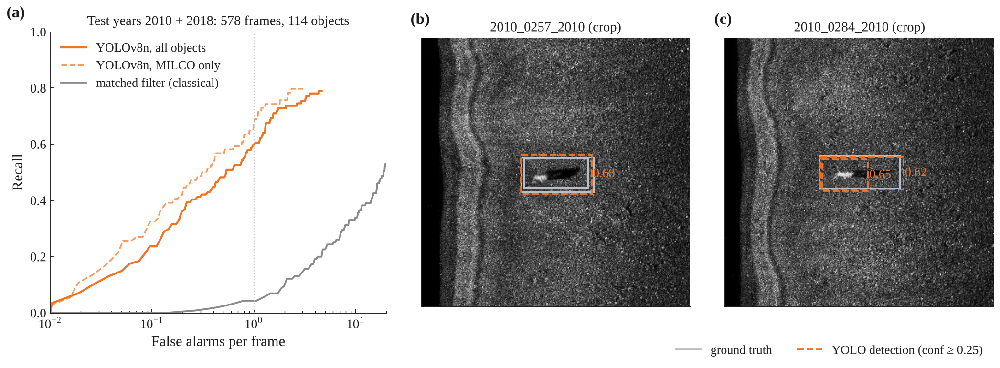
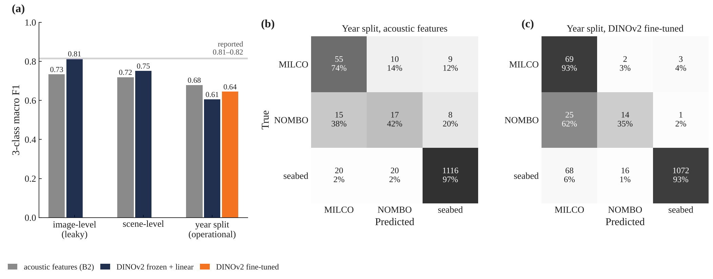
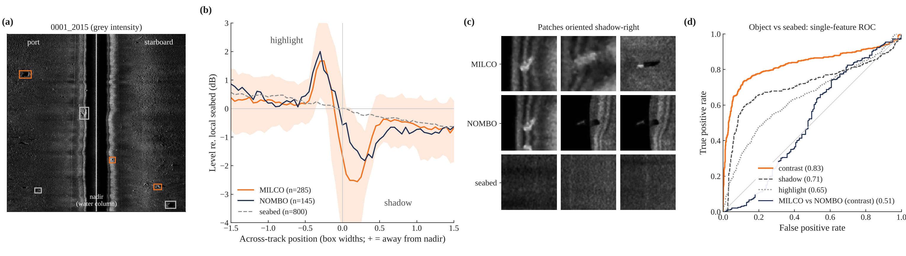
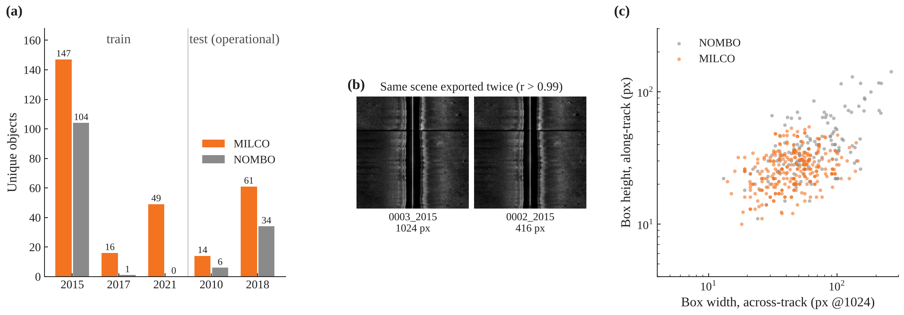

# Side B · SSS — 측면주사 소나 기뢰유사물체 탐지 · 분류 벤치마크

> **기뢰 탐지 벤치마크:** 연도 분리 평가, FROC 기준 재현율 78% (화면당 오경보 4건) · 정합필터 대비 비교 (화면당 오경보 1건: 59.6% vs 4.3%)

공개 측면주사 소나(Side-Scan Sonar, SSS) 영상으로 **기뢰유사물체(mine-like object) 탐지기와 패치 분류기의 성능을 각각 비교**하고, 중복 장면과 촬영 연도 변화가 평가에 미치는 영향을 분석한 개인 연구입니다. 하이라이트–그림자 특징을 이용한 영상 처리와 AI 모델(YOLOv8n · DINOv2)을 함께 평가했습니다.

| | |
|---|---|
| **상태** | 분석 완료 · 공개 데이터와 이 저장소 코드로 CPU 재현 가능 |
| **데이터** | Santos et al. 2024 (*Data in Brief*, CC BY 4.0) — Gavia AUV · Marine Sonic 900/1800 kHz, 영상 1,170장(고유 장면 753개), MILCO · NOMBO |
| **평가** | 공식 연도 분할(학습 2015 · 2017 · 2021 → 시험 2010 · 2018), 장면 · 이미지 분할 비교, FROC · mAP@0.5 · macro F1 |
| **검증 등급** | 공개 영상 자료 내 정량 평가 (원시 신호 · 실해역 · 탑재 성능 미검증) |

## 핵심 결과

| 결과 | 수치 | 의미 |
|---|---|---|
| YOLOv8n 탐지, 시험 연도 578화면 · 객체 114개 | 재현율 **78.1%** (화면당 오경보 4건) · **59.6%** (1건) | 학습에 없던 연도에서도 탐지 유지 |
| 고전 정합필터 탐지 | 재현율 **4.3%** (화면당 오경보 1건) | 같은 조건에서 학습 탐지기 대비 기준선 |
| 패치 3분류(MILCO · NOMBO · 배경), 연도 분할 | 물리 특징 macro F1 **0.679** vs DINOv2 고정 특징 0.606 | 장면 → 연도 분할 하락폭: 물리 특징 0.040, DINOv2 0.146 |
| 하이라이트–그림자 대비 특징 | 물체 vs 배경 AUROC **0.830** | 물체–배경 구분 단서 (MILCO–NOMBO 구분력은 제한적) |
| 중복 장면 진단 | 중복 **417쌍** → 고유 장면 753개 | 이미지 단위 분할의 성능 과대평가 확인 |

탐지 재현율과 패치 F1은 **서로 다른 실험**입니다. 패치 분류는 정답 위치 패치로 평가했으며, 탐지 후보를 분류기에 연결한 2단 구조의 연계 성능은 후속 검증 대상입니다.

<p align="center"></p>
<p align="center"><sub>YOLOv8n 단독 평가: 시험 연도 578화면 · 정답 객체 114개의 FROC와 탐지 예시(정합필터는 정답 115개)</sub></p>

## 구현 · 검증 범위

| 구분 | 현재 범위 | 확인 근거 |
|---|---|---|
| 구현한 기능 | 중복 장면 진단, 그레이스케일 변환 · 영상 크기 통일, 수주 검출 · 횡방향 이득 정규화, 하이라이트–그림자 특징, 정합필터 · YOLOv8n 탐지, 물리 특징 · DINOv2 패치 분류 | [`src/screen.py`](src/screen.py), [`src/b2.py`](src/b2.py), [`src/prep_tiles.py`](src/prep_tiles.py), [`src/b3_patch.py`](src/b3_patch.py) |
| 정량 검증: 탐지 | 전체 화면에서 탐지기 단독 FROC · mAP 평가 | [`src/b3_yolo_eval.py`](src/b3_yolo_eval.py), [`src/b3_yolo.json`](src/b3_yolo.json) |
| 정량 검증: 분류 | 정답 위치 물체 패치 + 무작위 배경 패치의 3분류 macro F1 평가 | [`src/b3_patch.py`](src/b3_patch.py), [`src/b3_patch.json`](src/b3_patch.json) |
| 설계 제안 | 탐지 후보를 분류기로 재판정하는 2단 구조, 후보 패치 중심의 전송 방식 | 아래 적용 방향. 탐지기–분류기 연계 성능과 전송 효과는 미검증 |
| 향후 시스템 적용 | UUV · XLUUV 탑재, 실시간 처리, 실해역 탐색 | 탑재 장비 · 실해역 자료를 이용한 추가 검증 필요 |

## 방법 상세

| 항목 | 내용 |
|---|---|
| 데이터 | Santos et al. 2024, *Data in Brief* 53:110132 (CC BY 4.0). Gavia AUV, Marine Sonic 900/1800 kHz SSS. 영상 1,170장(고유 장면 753개), 클래스 MILCO(기뢰유사물체) · NOMBO(비기뢰 물체) |
| 영상 처리 (물리 기반) | 중복 장면 검출(고역통과 영상 상관), 의사색상 영상의 그레이스케일 변환 · 영상 크기 통일, 수주(nadir) 검출, 횡방향 이득 정규화, 하이라이트–그림자(highlight–shadow) 특징, 고전적 정합필터 탐지기 |
| 탐지 | YOLOv8n, 320 px 타일 학습 → 1024 px 전체 화면 탐지 (CPU, 25 epoch) |
| 분류 | 정답 위치 패치의 영상 기반 물리 특징 + 로지스틱 회귀, DINOv2 고정 특징 + 선형 분류기, DINOv2 미세조정 (3분류: MILCO · NOMBO · 해저 배경) |
| 평가 | 공식 연도 분할(학습 연도 2015 · 2017 · 2021 → 시험 연도 2010 · 2018), 장면 · 이미지 분할 비교. 탐지는 중심 일치 기준 FROC와 mAP@0.5, 패치 분류는 macro F1 |

## 상세 결과

### 탐지기 단독 평가

시험 연도(2010 · 2018)의 **578화면 · 정답 객체 114개(MILCO 74개 · NOMBO 40개)**에 대한 YOLOv8n 결과입니다. 아래 FROC 재현율은 두 클래스를 합친 객체 위치 탐지 기준입니다.

| 지표 | 결과 |
|---|---|
| 객체 재현율, 화면당 오경보 1건 이하 | **59.6%** |
| 객체 재현율, 화면당 오경보 4건 이하 | **78.1%** |
| 전체 객체 탐지 mAP@0.5 | **0.101** |

근거: [`src/b3_yolo.json`](src/b3_yolo.json)의 `froc_operational.froc_obj`, `map_operational` 및 [평가 코드](src/b3_yolo_eval.py). FROC는 검출 중심과 정답 중심의 거리로 일치 여부를 판정하고, mAP는 박스 IoU를 사용하므로 서로 다른 평가 기준입니다. 결과 파일의 `operational`은 데이터셋의 시험 연도 구분을 뜻합니다. FROC 값은 시험 자료에서 신뢰도 임계값을 순회해 얻은 곡선상 성능이며, 실제 운용 임계값은 별도 검증 자료에서 설정해야 합니다.

고전적 영상 정합필터의 화면당 오경보 1건 기준 재현율은 **4.3%**입니다([`src/b2_results.json`](src/b2_results.json), `mf.operational`). 중심 일치 규칙은 같지만, 정합필터는 정답 115개, YOLO는 1024 px 기준 폭 또는 높이가 4 px 미만인 라벨을 제외한 114개를 사용하므로 이 차이를 고려해 비교해야 합니다.

### 정답 위치 패치의 독립 분류 평가

[`src/b3_patch.py`](src/b3_patch.py)는 정답 박스의 위치 · 크기로 물체 패치를 추출하고, 장면당 해저 배경 패치 2개를 별도로 뽑습니다. **YOLO 검출 후보를 입력으로 사용하지 않습니다.** 물체 · 배경 패치는 112 × 112 px로 변환하며, 연도 분할 시험 패치는 총 1,270개(MILCO 74 · NOMBO 40 · 배경 1,156)입니다.

| 모델 | 이미지 단위 5-fold¹ | 장면 단위 5-fold | 연도 분할 |
|---|---|---|---|
| 물리 특징 + 로지스틱 회귀 | 0.734 | 0.719 | **0.679** |
| DINOv2 고정 특징 + 선형 분류기 | **0.814** | **0.751** | 0.606 |
| DINOv2 마지막 4블록 미세조정 | — | — | 0.645 |

값은 MILCO · NOMBO · 해저 배경 **3분류 macro F1**입니다. 근거: [`src/b3_patch.json`](src/b3_patch.json)의 `naive|*`, `scene|*`, `year|*`, `counts`.

¹ 이미지 단위 분할은 축소 복사본을 포함해 같은 장면이 학습 · 시험에 함께 들어갈 수 있는 진단용 조건입니다. DINOv2의 0.814는 이 조건의 결과이며, 문헌 보고치 0.81–0.82와 동일한 분할 규약으로 재평가한 결과가 아니므로 직접적인 성능 동등성을 주장하지 않습니다. 장면 분할과 연도 분할을 비교하면 물리 특징 모델의 하락은 약 0.040, DINOv2 고정 특징 모델은 약 0.146으로, 본 비교에서는 물리 특징 모델이 연도 변화에 따른 하락이 작았습니다.

**위 탐지 재현율과 패치 F1은 별도 실험의 결과입니다.** 탐지 누락, 검출 위치 · 크기 오차, 탐지기가 만드는 오경보 후보를 포함한 2단 연계 재현율 · FROC · 최종 오경보율은 아직 검증하지 않았습니다.

### 영상 특징과 데이터 진단

- **하이라이트–그림자 대비**: 정답 위치 물체 vs 무작위 해저 배경 AUROC **0.830**(전체 연도), **0.775**(시험 연도). 전체 연도에서 그림자만 0.713, 하이라이트만 0.649이며, 대비 특징의 MILCO vs NOMBO AUROC는 0.513입니다. 물체–배경 구분의 단서이지만 MILCO–NOMBO 구분력은 제한적입니다. 주변 해저 대비 JPEG 밝기를 dB 형태로 변환한 영상 특징이며 보정된 음향 산란강도가 아닙니다. 근거: [`src/b2_shadow_auc.json`](src/b2_shadow_auc.json).
- **중복 장면 진단**: 영상 1,170장에서 중복 417쌍을 식별해 고유 장면 753개로 묶었습니다. 이미지 단위 분할의 성능 상승과 장면 · 연도 분할의 성능 차이를 함께 확인했습니다. 근거: [`src/screen.json`](src/screen.json)의 `years`, `pair_transforms`와 [진단 코드](src/screen.py).

<details>
<summary><b>그림 더 보기</b> — 패치 분류 · 하이라이트–그림자 특징 · 데이터 진단</summary>

<p align="center"></p>
<p align="center"><sub>정답 위치 물체 패치 + 무작위 배경 패치의 독립 평가: 분할별 3분류 macro F1과 연도 분할 혼동 행렬</sub></p>

<p align="center"></p>
<p align="center"><sub>영상 처리, 하이라이트–그림자 단면, 단일 특징 ROC (물체 vs 해저 · MILCO vs NOMBO)</sub></p>

<p align="center"></p>
<p align="center"><sub>데이터 진단: 연도별 객체 수, 축소 복사본, 표적 크기</sub></p>

</details>

기존 시각화 리포트는 [`docs/milco-report.html`](docs/milco-report.html)에 있습니다. 실험별 평가 범위와 수치의 해석은 위 설명과 연결한 원본 JSON을 기준으로 확인할 수 있습니다.

## UUV · XLUUV 적용 방향 (설계 제안 · 후속 검증)

- **2단 처리 구조 제안**: 탐지기로 후보를 생성하고 물리 특징 또는 영상 분류기로 재판정하는 구조를 검토할 수 있습니다. 다음 단계는 실제 검출 박스로 패치를 추출하고, 동일 시험 세트에서 탐지기 단독 대비 연계 후 재현율 · FROC를 비교해 오경보 억제 효과와 탐지 누락의 영향을 측정하는 것입니다.
- **후보 패치 전송 제안**: 통신량을 줄이기 위해 전체 화면 대신 후보 패치를 전송하는 방식을 고려할 수 있습니다. 예를 들어 1024 × 1024 화면 대비 64 × 64 패치 5개의 픽셀 수는 약 2%입니다. 이는 단순 픽셀 수 계산이며 실제 전송량 · 압축률 · 통신 지연을 측정한 결과는 아닙니다. 현재 분류기 입력 크기는 112 × 112입니다.
- **시험평가 확장**: 중복 장면 관리와 허용 오경보 수준별 평가 경험을 바탕으로, 해역 · 장비를 분리한 시험 자료와 탑재 하드웨어에서 처리 지연 · 메모리 사용량을 검증해야 합니다.
- **자료 · 모델 확장**: 원시 신호 또는 정합필터 출력, SAS 자료, 다양한 해역의 라벨과 GPU 학습을 활용한 후속 비교를 계획할 수 있습니다. 이에 따른 성능 향상은 추가 실험으로 확인해야 합니다.

## 실행

```bash
pip install -r requirements.txt
cd src
./download_data.sh          # 공개 데이터 내려받기 → raw/<year>/
python screen.py            # 중복 장면 · 연도별 통계 → screen.json
python b2.py                # 수주 검출 · 이득 정규화 · 정합필터 탐지기 FROC → b2_results.json
python b2_signature.py      # 하이라이트–그림자 단면 → b2_signature.json
python b2_shadow_auc.py     # 그림자 · 하이라이트 판별력 AUROC → b2_shadow_auc.json
python prep_tiles.py        # 1024 px 크기 통일 화면 + 320 px 타일
python train_yolo.py        # YOLOv8n 타일 학습 (CPU, Apple MPS는 device='mps')
python b3_yolo_eval.py      # 전체 화면 mAP · FROC → b3_yolo.json
python b3_patch.py 2        # 정답 위치 기반 독립 패치 3분류 → b3_patch.json
python build_report.py      # → milco-report.html
```

- 모든 스크립트는 `src/`에서 실행합니다. 결과 JSON과 [학습된 탐지기 가중치](src/runs/detect/runs/yolo_tiles/weights/best.pt)는 저장소에 포함되어 있습니다. 탐지 재평가에는 원자료 다운로드와 전처리가 필요하며, 저장된 JSON으로 리포트를 다시 생성할 수 있습니다. `b3_patch.py`는 특징 추출 · 분류 평가 · 미세조정을 함께 실행합니다.
- 원자료 영상, 타일, 특징 캐시(`*.npz`)는 용량 때문에 포함하지 않았습니다.

## 한계

- CPU로 학습한 소형 모델(YOLOv8n, 25 epoch)입니다.
- 입력은 JPEG로 내보낸 영상이며 원시 신호 · 이득 정보가 없습니다. 영상의 물리적 해상도를 통일한 것이 아니라 픽셀 축척을 통일했습니다.
- 분류 성능은 정답 위치 · 크기를 사용한 패치 조건의 결과이며, 실제 검출 후보에 대한 분류 성능과 2단 연계 성능은 미검증입니다.
- 라벨에 없는 물체도 오경보로 집계될 수 있습니다. 실제 오경보 수준을 판단하려면 해당 후보의 추가 라벨 검토가 필요합니다.
- 연도 분할 결과이며, 별도의 해역 · 장비 일반화, 실제 기뢰 식별, 실해역 운용 및 UUV · XLUUV 탑재 성능은 검증하지 않았습니다.
- 선행연구(Mine-JEPA 2026)는 분할 방식이 공개되지 않아 수치를 직접 비교할 수 없습니다.

## 데이터와 인용

- Santos, N. P. et al. (2024) Side-scan sonar imaging data of underwater vehicles for mine detection. *Data in Brief* 53, 110132. (CC BY 4.0)
- Mine-JEPA (2026) In-domain self-supervised learning for mine-like object classification in side-scan sonar. arXiv:2604.00383.
- Oquab, M. et al. (2024) DINOv2: Learning robust visual features without supervision. *TMLR*.
- Ultralytics YOLOv8.

## 관련 저장소

| | 저장소 | 내용 |
|---|---|---|
| **Side A · PAM** | [marine-mammal-classifier-benchmark](https://github.com/jongchan-joseph-lee/marine-mammal-classifier-benchmark) | 해양포유류 음향 분류 레퍼런스 모델 벤치마크 |
| **Side B · SSS** | sss-mine-detection-benchmark (현재) | 측면주사 소나 기뢰유사물체 탐지 · 분류 벤치마크 |
| **Side C · SAS** | [SAS_signal_processing](https://github.com/jongchan-joseph-lee/SAS_signal_processing) | 공개 합성 SAS 원시 신호 처리 · 영상 형성 검증 |

## 라이선스

코드는 MIT License를 따릅니다 (`LICENSE`). 데이터는 원 저작자의 CC BY 4.0 조건을 따릅니다.
